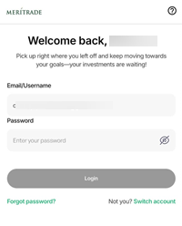
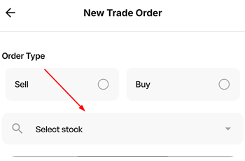
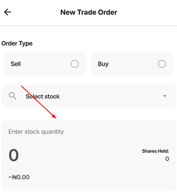
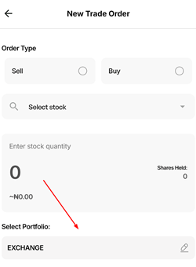
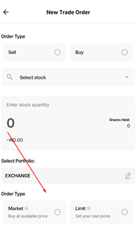
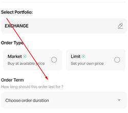
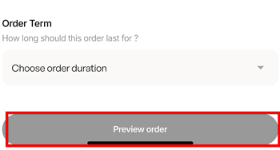
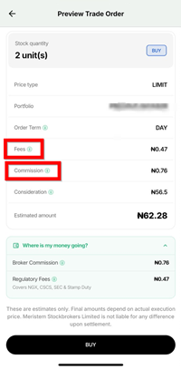
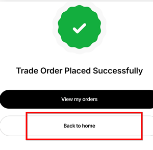

# How to buy stocks on Meritrade

### Overview (definition of the app, audience and purpose of this guide)

Meritrade is an online stock trading app owned and controlled by Meristem, used to buy and sell stocks on the Nigerian stock exchange, provide up-to-date market insights, and let users set up a watchlist for stocks of interest so they never miss an opportunity to buy or sell.

This guide walks you through the steps required to buy stocks on Meritrade.

### Prerequisites

* A funded Meritrade account. 
* Internet connectivity.
* A list of stock tickers/names to buy.

### Steps to take to buy stocks on Meritrade include:

1. ### Log in to your Meritrade account
     
**_An image showing the Log in page_**  
   Enter your email address and password to log in to your Meritrade account.

2. ### Click on `New Trade`
       
**_An image showing the location of `New Trade` on homepage_**

3. ### Select `Buy`
     
**_An image showing the location of `Buy`_**

4. ### Click on `Select stock`
      
   **_An image showing the search bar to be used to locate stock tickers_**   
   Use the search bar to locate the specific stock you want to buy.

5. ### Enter the quantity of stock you want to buy
      
   **_An image showing where you indicate the quantity of stocks you want to buy_**   
   As you enter the quantity of stock you want to buy, the price is reflected.

6. ### Click on `Select Portfolio`
     
   **_An image showing where you select your portfolio_**  
   When you created your Meritrade account, you were automatically assigned a portfolio. Select it.

7. ### Select `Order Type`
     
   **_An image showing the different order types_**

   There are two types of orders: 
   * **Market Order**: this is an instruction to buy the stock immediately at the best available price. Select this order if you want to buy the stock immediately, regardless of price.  
   * **Limit Order**: this is an instruction to buy only if the price gets to a certain level specified by you. Select this order when you want to buy a stock when it s at a specific price.
  
:::warning[Important]

Be mindful of when you plan to buy stock(s); try to buy when the market is still open. If you buy stock(s) after the market closes or before it opens, kindly note that you will only be able to place a limit order.

:::

1. ### Select `Order Term`
     
**_An image showing where to select Order Term_**  
   Order term specifies how long your order is valid for. For example, if you place a limit order with a 1-day term and the price you wanted isn't reached within that day, the order becomes invalid at the end of the day.

1. ### Click on `Preview order`
     
**_An image showing where to click to preview your order_**

     
**_An image showing the preview_** 

   Preview your order to ensure everything is correct. You also see the additional cost that comes with buying stocks, such as broker commission and regulatory fees.

1.  ### Click on `BUY`
      
**_An image showing the `BUY` button_**  
    Once you click on `BUY`, you will receive a copy of your trade order and a contract note in your email linked to Meritrade.

1.  ### Click on `Back to home`
      
    **_An image showing that your order was successful_**  
    Once the order has been successfully placed, you will see a message saying, `Trade Order Placed Successfully`.

