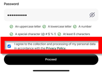
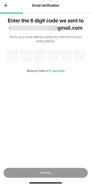
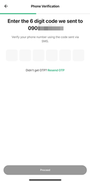
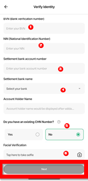
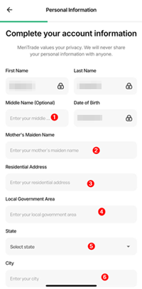
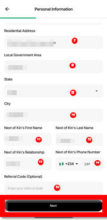
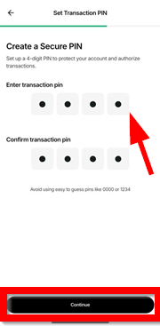

# Creating an individual account on Meritrade

### Overview (definition of the app, audience, purpose of this guide)
Meritrade is an online stock trading app owned and controlled by Meristem, used to buy and sell stocks on the Nigerian stock exchange, provide up-to-date market insights, and let users set up a watchlist for stocks of interest so they never miss an opportunity to buy or sell.
 
This documentation is for users new to buying and selling stocks on Meritrade. This guide walks you through creating an individual account on the Meritrade platform.

### Prerequisites
* A mobile phone with internet connectivity.
* A valid email address.
* A valid mobile number.
* Your BVN and NIN.

### Steps to take to create an account on Meritrade include:

1. ### Click on `Create account`
     
   **_An image showing where to click `Create an account`_**  
   The `Login` button is for users with an existing account on the app.  

:::warning[Important]

Please use an email address that has never been used to create an account on Meritrade, if not the system will flag it. In addition, your password must contain 8 characters consisting of an uppercase letter, a lowercase letter, a number, and a special character.

:::

2. ### Select `Individual`
       
**_An image showing where to select `Individual` to open an individual account_**

   On this page, two options are available to you:  
    * `Individual` — select this if you intend to buy and sell stocks on a personal basis. The fields for name, email address, and password will show; fill them out.
    * `Corporate` — select this if you intend to buy and sell as a business.
    
3. ### Tick the consent checkbox and click on `Proceed`
       
   **_An image showing where to tick the consent checkbox_**  
   Tick only after you have read the privacy policy.
   
4. ### Enter the verification code sent to the email you registered with 
     
   **_An image showing where to enter OTP sent to your email_**    
   A verification code will be sent to your email within 30 seconds, after which you will need to click on `Resend OTP`.
  
5. ### Enter the verification code sent to the number you registered with
     
   **_An image showing where to enter the OTP sent to your phone number_**  
   A verification code will be sent to your phone number within 30 seconds, after which you will need to click on `Resend OTP`.
   
6. ### Enter the required details for your identity Verification and click `Next`
     
   **_An image showing where to enter all the details required to verify your identity_**

   To verify your identity, fill out the following:
   * `BVN(Bank verification number)`
   * `NIN(National verification Number)`
   * `Settlement bank account number`
   * `Settlement bank name` — once filled out, the `Account Holder name` field is automatically filled in for you.
   * `Do you have an existing CHN Number?` — tick `Yes` or `No`. If `Yes`, enter your CHN. 

:::warning[Note]

CHN stands for Clearing House Number; it is a unique, permanent identification number assigned to every investor in the Nigerian Stock Exchange.

::: 

7. ### Enter the required details to `Complete your account information` and click `Next`
    

   **_An image showing the first half of the account information form_**

   
     
   **_An image showing the second half of the account information form_**  
   
   To complete your account information, fill out the following:
   * `Middle name (Optional)`
   * `Mother's Maiden Name`
   * `Residential Address`
   * `Local Government Area`
   * `State`
   * `City`
   * `Next of Kin's Relationship`
   * `Next of Kin's Phone Number`
   * `Referral Code (Optional)`  

8. ### Create your secure PIN and click on `Continue`  
      
    **_An image showing where to create your 4-digit PIN_**  
   Set up a 4-digit PIN to protect your account and authorize transactions. 
   

