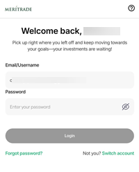
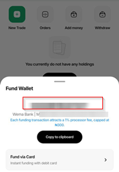
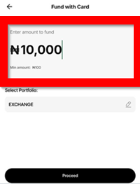
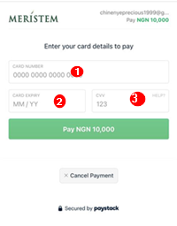
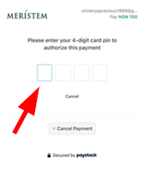
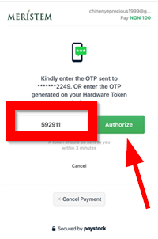

# How to fund your account on Meritrade

### Overview (definition of the app, audience, purpose of this guide)
Meritrade is an online stock trading app owned and controlled by Meristem, used to buy and sell stocks on the Nigerian stock exchange, provide up-to-date market insights, and let users set up a watchlist for stocks of interest so they never miss an opportunity to buy or sell.

To buy and sell stocks on Meritrade, you need to fund your Meritrade account, and this guide walks you through the steps.

### Prerequisites
* An existing Meritrade account. 
* Internet connectivity.
* A valid bank card (only required if funding via card; not needed for bank transfer).

### Steps to take to fund your Meritrade account include:

1. ### Log into your Meritrade account
     
**_An image showing the Log in page_**  
   Enter your email address and password to log in to your Meritrade account.

:::warning[Important]

Each funding transaction attracts a 1% processing fee, capped at ₦300. This means that for every amount you fund your account with, 1% is deducted as a fee, but if that 1% exceeds ₦300, only ₦300 will be deducted regardless.

:::

2. ### Click on `Add money` 
     
  **_An image showing the location of `Add Money`_** 

   There are two ways to fund your account: 
* **Through bank transfer:**   
     
**_An image showing the account number to copy and bank name to transfer money to_**

    Copy the displayed account number and perform the transaction in your bank app. You will receive emails from Paystack and Meristem, and your funds will be reflected in your account shortly.

* **Through your bank card:**
  1. #### Click on `Fund via Card`  
       
  **_An image showing where to locate `Fund via Card`_**

  2. #### Click on `Add New Card`   
      
  **_An image showing where to locate `Add New Card`_**

  3. #### Input the amount you want to fund your account with 
      
  **_An image showing where to enter amount you want to fund your account with_**

  4. #### Click on `Proceed`  
      
  **_An image showing where to click on `Proceed`_**  

  5. #### Enter your card details (card number, card expiry, CVV) to fund your account
      
  **_An image showing where to enter your card details_**

  6. #### Enter your 4-digit card PIN to authorize the payment
      
  **_An image showing where to enter your 4-digit card PIN_**

  7. #### Enter the OTP sent to your phone number or generate it on your hardware token, then click `Authorize`
      
  **_An image showing where to enter the OTP generated or sent_**

  8. #### Click on `Back to home`  
      
  **_An image showing where to click on `Back to home`_**

     A `Funding request is being processed` message confirms your request went through. You will also receive emails from Paystack and Meristem, and your funds will reflect in your account within a short period.

