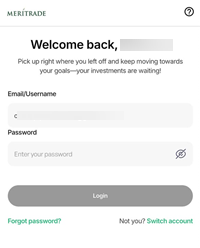
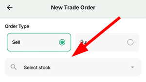
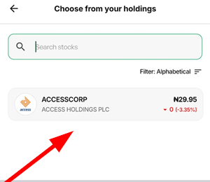
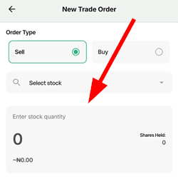
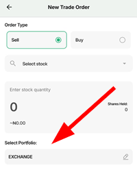
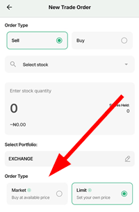
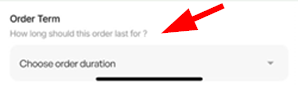
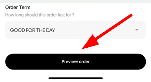
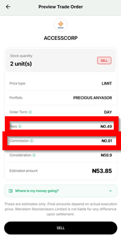
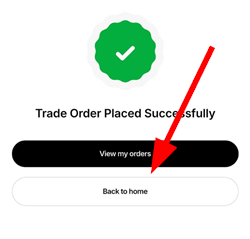

# How to sell stocks on Meritrade

### Overview (definition of the app, audience, purpose of this guide)
Meritrade is an online stock trading app owned and controlled by Meristem, used to buy and sell stocks on the Nigerian stock exchange, provide up-to-date market insights, and let users set up a watchlist for stocks of interest so they never miss an opportunity to buy or sell.

This guide walks you through the steps required to sell your stock(s) on Meritrade.

### Preresiquites
* A Meritrade account.
* Internet connectivity.
* A list of stock tickers/names to sell.

### Steps to take to sell stocks on Meritrade include:

1. ### Log in to your Meritrade account
     
**_An image showing the Log in page_**   
   Enter your email address and password to log in to your Meritrade account.
   
2. ### Click on `New Trade`
     
**_An image showing the location of `New Trade` on homepage_** 

3. ### Select `Sell`
     
**_An image showing the location of `Sell`_**

4. ### Click on `Select Stock`  
      
   **_An image showing the search bar to be used to locate stock tickers_**  
      
   **_An image showing the list of stocks that you own so you can the ones you want to put up for sell_**  
   Only the stocks you have bought previously will show up; select the ones you want to sell.  

5. ### Enter the quantity of stock you want to sell 
      
   **_An image showing where you indicate the quantity of stocks you want to buy_**  
   As you enter the quantity of stock you want to sell, the price is reflected.

6. ### Click on `Select portfolio`   
     
    **_An image showing where you select your portfolio_**  
    When you created your Meritrade account, you were automatically assigned a portfolio. 

7. ### Select `Order Type` 
      
   **_An image showing the different order types_**

   There are two types of orders:
* **Market:** this is an instruction to sell the stock immediately at the best price available. Select this order if you want to ensure the stock sells, regardless of price.

* **Limit:** this is an instruction to sell only if the price gets to a certain level specified by you. Select this order when you want a stock only if it is sold at a specific price entered by you.

:::warning[Important]

Be mindful of when you plan to sell your stock(s); try to sell when the market is still open. If you sell your stock(s) after the market closes or before it opens, kindly note that you will only be able to place a limit order.

:::

8. ### Select `Order Term`
     
**_An image showing where to select Order Term_**

   This tells those selling your stock(s) for you how long your order is valid for. For example, if you give a limit order and you set 1 day as your order term, if after 1 day, your stock is not sold at the price you wanted, then by the end of the day your order becomes invalid.

9.  ### Click on `Preview Order` 
     

    **_An image showing where to click to preview your order_**

    

    **_An image showing the preview_**  
   Preview your order to ensure everything is correct. You also see the additional cost that comes with selling stocks, such as broker commission and regulatory fees.

10.  ### Click on `SELL` 
       
**_An image showing the `SELL` button_**  
     Once you click on `SELL`, you will receive a copy of your trade order and a contract note in your email linked to your Meritrade account.

11.  ### Click on `Back to home`
       
    **_An image showing that your order was successful_**  
     Once the order has been successfully placed, you will see a message saying, `Trade Order Placed Successfully`, then click `Back to home`. In addition, once your stock is successfully sold, it will be reflected in your available balance, and you will be notified through SMS as well.